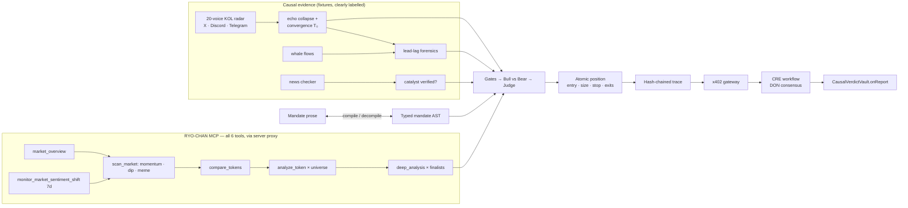

# Causal-Verdict CRE

**An autonomous practice-trade agent that reads real RYO-CHAN MCP evidence, argues both sides, obeys a compiled fiduciary mandate, and anchors every verdict through a Chainlink CRE workflow.**

BLI Legal Tech Hackathon 2 · RYO-CHAN *Autonomous Agents* · Chainlink *Best workflow with CRE* · BLI LegalTech main track

> Practice trades only. This is research tooling, not financial advice. RYO-CHAN MCP is read-only, and nothing in this repo places, approves or executes a trade.

---

## Judge path (3 minutes)

**Live app:** https://causal-verdict-cre.onrender.com (full server: live RYO, Claude analyst, x402 payments that settle on Base Sepolia) · **Static replay:** https://dino1x.github.io/causal-verdict-cre/ · **Repo:** https://github.com/dino1x/causal-verdict-cre


**Built on RYO, not around it.** Every decision comes from RYO-CHAN MCP's six tools (`market_overview`, `monitor_market_sentiment_shift`, `scan_market`, `compare_tokens`, `analyze_token`, `deep_analysis`), called through a server proxy that keeps the key off the browser. Without a key, the app replays 17 real captured RYO responses, hashed and labelled. The app opens on a **Judge** tab that mirrors this section, with a "Show me" button on every row.

**On-chain proofs and a Bitcoin timestamp**

| What | Proof |
|---|---|
| Vault deployed on Sepolia, bound to the mandate hash | [deploy tx](https://sepolia.etherscan.io/tx/0x4cca438a56f868df390340092d08f3e76716e1319ec4643a8b21d0143b82925a) · [vault](https://sepolia.etherscan.io/address/0xb86d25cd0317de545c8573f040a589c34a093544) |
| CRE workflow wrote a verdict on-chain (`cre workflow simulate --broadcast`) | [report tx](https://sepolia.etherscan.io/tx/0xea20a213693990660226b817c94b85ea4c1b6e7bc66c409e5fb4d36797c81cc6) · `npx tsx scripts/read-vault.ts` |
| The CRE workflow read Chainlink SOL/USD itself, checked RYO's price against it (clause 16), then wrote the verdict | [report tx](https://sepolia.etherscan.io/tx/0xc4e4dd3024e12a24c99c7918fa70880fa9dd05b3a05135cbc96a13ff7588547f) · [mandate activation](https://sepolia.etherscan.io/tx/0x3ec3beb1a5519c213d14eed5003bb5fcc599fea4616949f0a3a7cd5ed0ba07c7) |
| An agent paid for a verdict over x402, settled before it was served. Every click on the live app's CRE · x402 page settles its own payment ([example](https://sepolia.basescan.org/tx/0xb26516daa8b19e430dbf520878bfcd5e57a6f35ee7b4758d32d1096250dbab41)) | [Base Sepolia tx](https://sepolia.basescan.org/tx/0x0406f0749a6958723822ebf24cd3d85376f11ca13ef0c01bbba63bf9daa04bf7) |
| Ledger head timestamped into Bitcoin | [`witness/heads/`](witness/heads/) · the first head is confirmed in **Bitcoin block 973,943**; later heads read pending until a block confirms them · `ots verify <file>.ots` |

**Check it yourself, in the browser**

| Check | Where |
|---|---|
| Replay the run from the recorded RYO envelopes and get the identical trace root | Audit → Replay |
| Edit one reasoning step and watch the chain break | Audit → Edit one step |
| Re-hash every RYO exhibit | Audit → Re-hash all exhibits |
| Re-verify the practice-trade ledger, and tamper with a private copy | Ledger → Check it yourself |
| Compile the mandate to an AST and back to the same prose | Mandate |
| Pay for a verdict over x402 (402 → signed retry → 200 → replay refused) | CRE + x402 |

**Attack battery** (`scripts/battery.ts`, part of `npm test`): 184 attacks on copies of the live ledger, a ledger with real positions, and a reasoning trace. The hash chains catch every edit, deletion and swap. Truncating the tail or re-hashing the whole history leaves a valid chain, and only the published head catches those. With the witnessed head, **0 of 184 are missed**.

**Rubric map**

| Prize · criterion | Where it is |
|---|---|
| RYO · Combining sources (20%) | Six RYO tools chained into one gated decision with on-chain whale transfers, Whale Alert, news (RSS, Telegram, Tavily), Telegram voices, an exchange plane and a Chainlink reference price (Verdict, Causality) |
| RYO · Coping with failure (20%) | Rate-limit headers, circuit breaker with `Retry-After`, labelled snapshot fallback, null kept null, paced loop, chaos injector (Verdict) |
| RYO · Real thinking (25%) | Bull/Bear over structured RYO fields, a mandate-bound Judge, and a citation-checked Claude debate (Debate) |
| RYO · Cause and effect (20%) | Whale lead-lag forensics, echo collapse, catalyst verification, and a Why column per candidate per run (Causality, Ledger) |
| RYO · Repeatability (10%) | Hash-chained trace with exact replay; ledger head witnessed in git, Bitcoin and Sigstore (Audit, Ledger) |
| RYO · Advanced execution (5%) | Atomic entry, size, stop, tranches, targets and time stop, anchored by CRE (Verdict, CRE + x402) |
| Chainlink · CRE workflow + CLI simulation | `cre-workflow/` · Cron and HTTP triggers · Confidential HTTP · `simulation-cre-cli-*.log` · report tx above |
| Chainlink · x402 · AI-generated workflows · risk monitoring | settled payment above · intent → mandate → generated config (CRE + x402) · hourly cron trigger |
| BLI · fiduciary mandate, §17(b), MiCA Art. 91–92, FRE 902(13)/(14) | Mandate compiler and decompiler · binding touting/exit-liquidity gates · draft STOR · evidence package (Mandate, Debate, Audit) |

**Runs in public.** `.github/workflows/agent.yml` runs the agent hourly on live RYO, then commits the ledger and signs its head in Sigstore with the workflow's own identity. `.github/workflows/pages.yml` publishes the replay-mode site.

---

## 60-second tour

```bash
npm install
cp .env.example .env        # optional: add RYO_MCP_KEY for live calls
npm run dev                 # http://localhost:5173
```

The app opens on a **replay of 17 real RYO-CHAN MCP responses** (all six tools, captured 2026-10-30 19:22–19:28 UTC), so a judge without a key sees the full agent at once. With a key in `.env`, switch to **Live RYO MCP**: the browser calls our server proxy, and the proxy calls RYO with the key held server-side.

The app has two evidence modes for the KOL, whale and news planes:
- **Real feeds** (the default). Public on-chain ERC-20 transfers, Whale Alert, crypto RSS and Telegram channels, each item linked to its source.
- **Scenario fixtures.** A fictional scenario built to show the exit-liquidity trap.

What the agent concluded on the captured RYO data with the **scenario** evidence:

| Token | Verdict | Why (first binding reason) |
|---|---|---|
| **SOL** | **SELECT**: entry $93.75, stop $87.66 (1.5×ATR), targets $99.83 / $105.92, 7.7% notional, $500 at risk | RSI 29.4 oversold; RYO confluence 0.67; whales withdrawing from exchanges; Polygon integration corroborated by RYO's own token profile; size halved because the regime is `risk_off` |
| BEAM | REJECT | **Exit-liquidity trap.** 3 wallets accumulated $4.05M 66 min *before* KOL convergence, then 2 sent $3.21M to exchanges 17 min *after* it. RYO returned `rsi_14: null` (treated as a failed gate, never 0). The Bull side argued RYO's confluence of 1.0 and still lost. |
| Q | REJECT | ATR(14) 85% of price, over the 25% tolerance |
| MAGMA, GROW | REJECT | Turnover of 3% and 0.1% of market cap: a stop could not be filled. GROW is RYO `compare_tokens`' own pick, and the mandate still rejects it: relative strength is not suitability. |
| PEPE | REJECT | RYO RSI/ATR unavailable (`partial`); 4 near-identical KOL posts collapse into 1 voice |

With **real feeds** captured for the same reference time (`src/data/feedSnapshots.json`: 18 on-chain whale transfers across BEAM, GROW, PEPE and Q, plus 2 news articles), **SOL is again the only SELECT**. It is supported by RYO market data and a catalyst that real news (CoinDesk, Decrypt) and RYO's own token profile both report: Polygon extending stablecoin payments to Solana. BEAM is still rejected, for RYO's missing RSI/ATR and too few supporting planes. Its real flows show **no** exit-liquidity trap at capture time, so that rule passes on real data. The scenario exists to show the trap firing.

---

## How it works



### 1 · RYO-CHAN research funnel (`src/engine/pipeline.ts`)
Each run makes 17 calls across **all six tools**. It chains them; it does not just print a summary. The scan shortlist drives `compare_tokens`, which drives `analyze_token` on the whole universe and `deep_analysis` on the finalists. Decisions read **structured `data` fields** (RSI-14, ATR-14, confluence gates, perp veto, `trade_plan`, 7-day funding crowding and liquidation share), never `summary` text.

### 2 · Cause and effect (`src/engine/evidence.ts`)
- **Multi-KOL radar.** Up to 20 user-weighted voices. For each post it extracts cashtags, sentiment, conviction, urgency, disclosure and claims from a fixed lexicon, so the output is deterministic.
- **Echo collapse.** Posts with ≥50% word-trigram Jaccard overlap count as one voice.
- **Convergence T₀.** The first moment ≥3 independent voices fall inside the mandate's window.
- **Whale lead-lag.** Wallets that accumulated ≥15 min before T₀ and sent to exchanges inside the post-T₀ window form a **manufactured exit-liquidity trap**.
- **News checker.** A claim counts as verified only from a primary source or from RYO's own token-profile text. A secondary wire alone is not verification.

### 2b · Real evidence feeds (`server/feeds.ts`, keyless, server-side)
| Plane | Source | Notes |
|---|---|---|
| Whale flows | `eth_getLogs` ERC-20 `Transfer` events from public Ethereum and BSC RPCs, for the contract address **RYO's `scan_market` returned**, over the 3h before the reference time | Transfers ≥ $25k (valued at RYO's price). Classified as exchange deposit or withdrawal against a small best-effort list of public CEX wallet labels, or as a DEX buy or sell when one side is a contract. EOA→EOA transfers are not attributed. Every event links to Etherscan or BscScan. |
| Whale flows (non-EVM) | Whale Alert's public Telegram channel | Parsed "X $TOKEN (Y USD) transferred from A to B" posts. Covers assets like SOL that have no EVM contract. |
| News | Cointelegraph, Decrypt and CoinDesk RSS | Matched by cashtag, ticker or RYO asset name. Outlets count as *secondary* sources: a claim is verified only by a primary source or corroborated by RYO's own token profile. |
| KOL voices | 11 public Telegram channels verified as active (Lookonchain, Watcher.Guru, Whale Alert, Cointelegraph, Wu Blockchain, BWEnews, CoinDesk, Unfolded, Bitcoin Magazine, CryptoQuant, Glassnode), editable in the Causality tab, ≤ 20 | X and Discord need a paid API or a bot, so posts from those are pasted in and labelled *user-supplied* |
| Primary sources | Exchange announcement channels (Binance, Bybit, OKX) | Routed to the news checker as **primary** evidence, since the venue is the source itself, not into the KOL radar |
| **Exchange market data** (`server/market.ts`) | Binance, then OKX, then Bybit public APIs: the 24 hourly candles that closed before the reference time, the perpetual funding rate and the 24h open-interest change | Feeds a new **exchange plane**, scored symmetrically (it can support or oppose a trade), and lets the ledger see highs and lows between runs. A pair whose last candle is stale is treated as **delisted or a different asset sharing the ticker** (Binance's old BEAMUSDT is caught this way) |
| **Chainlink Data Feeds** | `SYM / USD` aggregators on Ethereum mainnet, read through public RPCs at the round that was current at the reference time | Each address is checked by its own `description()` on every read. It is the reference price for clause 16 when one exists; otherwise the latest exchange close |
| **Tavily news search** | RYO's recommended news source, used when `TAVILY_API_KEY` is set (at most `TAVILY_MAX_TOKENS` tokens per run, default 2) | Results without a publication date are dropped, because their timing can't be checked against the reference time |

**No look-ahead:** anything timestamped after the run's reference time is dropped. Feeds that fail or have no coverage (e.g. MAGMA is a Sui token) are listed as **unavailable** in the feed-status table, never filled in. Feed inputs are hashed into the trace (`evidence.inputs`), so real-feed runs replay to an identical root too.

### 2c · Practice-trade ledger (`src/engine/ledger.ts`, `scripts/run-agent.ts`, Ledger tab)
The bounty asks agents to *record the practice trades they would make*. An autonomous loop runs the full agent on **live** RYO data and real feeds every 15 minutes, paced to RYO's rate limits. It records each practice trade, then re-prices open positions with later RYO observations and closes them at the stop, the targets (50% at T1, after which the stop moves to entry) or the 72-hour time stop. The ledger is append-only and hash-chained. It accepts **only live evidence**: a run whose `market_overview` wasn't live, or whose selected token's reads weren't live, is logged as *not recorded*. Prices older than a position never mark it. Between runs, the exchange's hourly candles decide whether a stop or target was touched; if one candle reaches both, the stop is assumed first (the conservative reading). At each run, RYO's price marks the position.

### 3 · Real thinking (`src/engine/decision.ts`)
Bull and Bear agents argue from the *same* evidence. Every argument cites the exact field it rests on (e.g. `deep_analysis(SOL).data.technical_analysis.rsi_14 = 29.4`). The **Judge has no discretion over the mandate**: a failed binding clause rejects the trade however good the bull case sounds. For each rejection it lists the formal counterexample and "what would change the ruling".

### 3b · Claude analyst debate (`server/llmDebate.ts`, Debate tab)
Claude Opus 5.5 argues Bull and Bear from the **same structured evidence** the deterministic agents use, then writes the causal story and "what would change my mind". It returns structured output through a Zod schema. Every claim must cite one path from an allow-list built from the run's evidence fields; claims that cite anything else are **dropped and counted**. The analysis is **advisory**: the mandate-bound Judge still decides, so the hash-chained run and its replay are unaffected. Each response is SHA-256 hashed so it can be filed with the decision. The call runs server-side (`ANTHROPIC_API_KEY` never reaches the browser), and a refused request is checked rather than shown as analysis. Static hosting has no analyst; the panel says so.

### 4 · Atomic execution plan
Entry, size, stop and exits are one object. RYO's ATR-14 `trade_plan` is the starting point, then mandate clauses apply: risk % per trade, max position, `max(entry − k·ATR, entry·(1 − cap))` stop, and regime scaling. Two dip tranches (60% at entry, 40% half an ATR lower), 50/50 exits at 1R/2R, a 72-hour time stop.

### 5 · Repeatability (`Trace` in `pipeline.ts`, Audit tab)
Every step is hashed as `hash(prev | i | label | sha256(payload))`. The engine has no clock and no randomness, so **Replay** on the recorded envelopes reproduces the identical root (`0xbd8063e1…9934` on the bundled RYO snapshots with the bundled real feeds). Editing any step breaks the chain at that step.

---

## BLI LegalTech: bidirectional fiduciary mandate compiler (`src/engine/legalAstCompiler.ts`)

- **Prose → AST.** A controlled-language grammar with 15 clause types. Prose it cannot parse is **rejected with a line number, never guessed**. Duplicate or conflicting limits and out-of-range values are compile errors.
- **AST → prose.** A deterministic, non-LLM decompiler. `decompile(compile(x))` is a tested fixpoint, so there is no semantic drift. Edit a number in the AST and the prose rewrites itself; edit the prose and the AST rebuilds.
- **One AST, three enforcers.** The in-browser Judge, the x402 gateway and the on-chain CRE workflow (`config.staging.json` is generated from the AST, and `mandateHash` is checked by the vault) all evaluate the same AST.
- **Legal anchors** on every clause:
  - UPIA §2 (standard of care; liquidity and economic conditions as listed circumstances)
  - UPIA §2(d) (duty to verify facts: clause 16 checks RYO's price against Chainlink or exchange trades before acting)
  - UPIA §3 (diversification)
  - Securities Act §17(b) (anti-touting; it reaches *securities*, so the clause flags undisclosed coordinated promotion whatever the token's status)
  - **MiCA Art. 91(2)** (manipulation, including voicing opinions while positioned)
  - **MiCA Art. 92** (the duty to run systems that detect market abuse; the touting and exit-liquidity detectors are that kind of control)
- **Regulatory documents, generated per decision** (Debate tab → Judge; samples in [`examples/`](examples/)):
  - a **pre-trade compliance memorandum**: determination, the atomic position, a clause-by-clause mandate test with anchors, the UPIA §2(c) circumstances considered, the arguments weighed, hash-identified evidence and limitations;
  - a **draft suspicious transaction and order report (STOR)**, structured for review under **MiCA Art. 92(1)–(2)**. It is offered *only* when the exit-liquidity or touting detector fires, and contains a dated chronology with source links, the addresses involved, reasons for suspicion, alternative explanations and a reviewer sign-off. It is never auto-filed; filing is a human decision. The draft states that the Art. 92 duty belongs to persons professionally arranging or executing crypto-asset transactions, for whom it is a detection aid, and that a detector firing is a ground for review, not a finding.
- **FRE 902(13)/(14) evidence package** (Audit tab). Each RYO exhibit is copied data identified by SHA-256 over key-sorted JSON, which is the 902(14) route. The reasoning trace is machine-generated, so its foundation is 902(13): the process produces an accurate result, shown by replaying the exhibits to the identical trace root. The package carries a **draft** 28 U.S.C. §1746 certification for a qualified person, covering qualification, retrieval process, digest recomputation and replay. It also states the 902(11) written-notice requirement and its limits: it covers authenticity only, not hearsay or relevance, and the digests prove integrity since retrieval, not that the market data was accurate. **We do not claim self-authentication without that signed human certification.**

---

## Chainlink CRE (`cre-workflow/`)

| File | What it is |
|---|---|
| `causal-verdict/main.ts` | `@chainlink/cre-sdk` 1.23 workflow. **Cron trigger** (automated risk monitoring of a watchlist) plus an **HTTP trigger** restricted to the x402 gateway's key. RYO-CHAN MCP is read through **`ConfidentialHTTPClient`** by default: the `RYO_MCP_KEY` Vault-DON secret is templated into the `Authorization` header *inside the enclave*, so no node operator ever sees it. This path also fits RYO's ~30s `deep_analysis` under the 90s Confidential HTTP limit; the standard HTTP capability is capped at 10s. Each RYO lane degrades on its own: if `deep_analysis` fails, the workflow falls back to `analyze_token` and marks confluence, derivatives and trade plan *unavailable*, and the mandate decides. With `ryoTransport: "http"`, every node reads RYO via `HTTPClient` and the DON agrees through `ConsensusAggregationByFields` (`median` on numbers, `identical` on strings and flags). The mandate is evaluated, the verdict is ABI-encoded into `runtime.report`, and `EVMClient.writeReport` sends it to the vault on Sepolia. |
| `causal-verdict/logic.ts` | Pure gate, sizing and report-encoding logic shared by the WASM workflow and the local harness. `null`s travel as explicit `*Available` flags. |
| `causal-verdict/config.staging.json` | **Generated from the mandate AST** (`npx tsx scripts/gen-cre-config.ts`) |
| `contracts/CausalVerdictVault.sol` | `IReceiver.onReport`. Accepts the forwarder only, requires the **active mandate hash**, rejects replayed `runId`s, and rejects any internally inconsistent SELECT (failed gates, stop ≥ entry, target ≤ entry). Holds no funds. |
| `simulate.ts` | Local DON round: 4 nodes, field-wise consensus, report ABI, and **`onReport` executed in a real EVM** (`@ethereumjs/evm`) from the forwarder address. Includes negative tests. |
| `simulation-cre-cli-http.log` / `simulation-cre-cli-cron.log` | **Official `cre workflow simulate` output (CLI v1.39.0)** for the HTTP (x402) and Cron triggers |
| `simulation-live.log` / `simulation-snapshot.log` | Local DON-round harness output, live and from snapshots |

**AI-assisted workflow generation** (CRE + x402 tab): plain-English risk intent → drafted mandate → **compiler validates it** → generated `config.staging.json` plus readable `gates.ts`. The drafter only proposes; the compiler is the gatekeeper, so a workflow never ships ambiguous rules.

**x402 agent micropayments** (`server/api.ts`, `/api/agent/verdict`):
1. The agent's first request gets `402` with `exact`-scheme requirements (0.01 USDC on Base Sepolia).
2. The agent signs an EIP-3009 `TransferWithAuthorization`.
3. The gateway verifies the EIP-712 signature, payee, amount, validity window and nonce (replays are refused).
4. With `X402_SETTLE=1`, the gateway then has the public x402 facilitator (`https://x402.org/facilitator`, x402 v1 `exact` on `base-sepolia`) submit the transfer on Base Sepolia. The verdict is served **only if settlement succeeds**, and the receipt carries the BaseScan transaction.
5. It returns the verdict, an `X-PAYMENT-RESPONSE`, and the exact payload it forwards to the CRE HTTP trigger.

A paid verdict is computed on **real evidence only**: live feeds on a live run, otherwise the bundled real feed capture. It is never computed on the scenario fixtures, and the response states its `evidenceMode` and feed status.

The UI runs the flow with an ephemeral, unfunded browser wallet, so no funds move there. A real agent pays with `npx tsx scripts/x402-pay.ts [server] [SYMBOL]`, which uses `SEPOLIA_PRIVATE_KEY` on Base Sepolia. **Settled for real:** [0.01 USDC on Base Sepolia](https://sepolia.basescan.org/tx/0x0406f0749a6958723822ebf24cd3d85376f11ca13ef0c01bbba63bf9daa04bf7), submitted by the facilitator, from the agent wallet to the merchant, before the verdict was served. With an unfunded payer the transfer reverts and the gateway refuses the verdict with a 402. Test USDC: [faucet.circle.com](https://faucet.circle.com).

```bash
npm run contract:compile       # solc 0.8.24 → contracts/out/CausalVerdictVault.json
npm run cre:simulate           # live RYO if RYO_MCP_KEY is set, else real snapshots
npm run cre:compile            # bun + @chainlink/cre-sdk → cre-workflow/causal-verdict/dist/workflow.wasm
# Official CLI simulation (needs a CRE account: `cre login` once)
cd cre-workflow
# .env needs RYO_MCP_KEY_ALL (= your RYO key) and CRE_ETH_PRIVATE_KEY (throwaway)
cre workflow simulate ./causal-verdict --target staging-settings --env ../.env \
  --trigger-index 1 --http-payload http-payload.example.json
cre workflow simulate ./causal-verdict --target staging-settings --env ../.env --trigger-index 0   # cron path
```

---

## RYO-CHAN rules and rubric

| Rule / criterion | Where |
|---|---|
| **Key never reaches the browser** | `.env` is gitignored. All live calls go `browser → /api/ryo/call → server/api.ts → RYO`. No `VITE_` variables exist. `npm run check:secrets` scans every shippable file, including `dist/`, for the key. |
| **No fabricated RYO data** | Snapshots are verbatim envelopes from `scripts/capture-ryo.mjs`, each with its SHA-256, re-verifiable in the browser. A request with no live answer and no snapshot is shown as **unavailable**, never invented. KOL, whale and news inputs come from real public feeds with per-item links. The fictional scenario is a separate, labelled mode. |
| **Envelope preserved** | `schema_version`, `status`, `data_mode`, `as_of`, `availability` and `warnings` are shown per exhibit (click any funnel chip). `null` stays `null`: BEAM's missing RSI fails a gate rather than reading as 0. |
| Combining sources (20%) | 6 tools × 17 calls chained into one decision, plus KOL, whale, news (RSS, Telegram, Tavily) and exchange planes, and a Chainlink reference price. The `min_planes` clause requires ≥2 independent planes to agree. |
| Coping with failure (20%) | Reads `X-RateLimit-*`. The capture client retries 429/503/network errors with exponential backoff and jitter. The live proxy fails fast into a **circuit breaker** (honours `Retry-After`), which sends calls to real snapshots during an outage. **Chaos injector** (429, 503, timeout, offline). Every fallback carries its reason. `partial` lanes stay visible. *This was exercised for real: RYO went unreachable during the build, and live runs degraded to labelled snapshots in about 20 s.* The autonomous loop runs in a separate **patient mode**. RYO also enforces a per-key `6/min for mcp_fanout` limit, and a 17-call burst hit it. So the loop queues calls behind a sliding 6-per-minute window and waits out each 429's `Retry-After` instead of falling back. Live calls per run went from 5/17 to 15–17/17 (tested offline against a mock in `scripts/patient-test.ts`). |
| Real thinking (25%) | Adversarial Bull/Bear over structured fields, a Judge bound by the AST, counterfactuals |
| Cause and effect (20%) | Lead-lag timeline, a causal chain per token, explained rejections |
| Repeatability (10%) | Hash-chained trace, 1-click deterministic replay, tamper demo, `npm test` |
| Advanced execution (5%) | Atomic entry/size/stop/exit, anchored through CRE with `writeReport` |

---

## Verification status (honest)

| Claim | Status |
|---|---|
| 17 real RYO responses captured, all 6 tools | ✅ `src/data/ryoLiveSnapshots.json`, `src/data/ryoCaptureLog.txt` |
| Engine invariants (round-trip, replay, tamper, null handling, trap detection) | ✅ `npm test` |
| Workflow type-checks against `@chainlink/cre-sdk@1.23.0` (strict) | ✅ `cd cre-workflow/causal-verdict && npx tsc` |
| Vault accepts the workflow's report bytes in a real EVM; non-forwarder reverts | ✅ `npm run cre:simulate` |
| Live RYO inside the local DON round | ✅ `cre-workflow/simulation-live.log` |
| x402 402 → signed retry → 200 → replay refused | ✅ in-app (CRE + x402 tab) |
| **x402 payment settled on-chain** | ✅ an agent wallet paid 0.01 USDC for a SOL verdict; the public facilitator submitted `transferWithAuthorization` and the gateway served the verdict only after settlement: [BaseScan tx](https://sepolia.basescan.org/tx/0x0406f0749a6958723822ebf24cd3d85376f11ca13ef0c01bbba63bf9daa04bf7) · [`examples/x402-settlement-base-sepolia.json`](examples/x402-settlement-base-sepolia.json). An unfunded payer is refused with 402. |
| Workflow compiles to WASM with the SDK's `cre-compile` (Javy), passing its type-check and its restricted-API check | ✅ `npm run cre:compile` → `dist/workflow.wasm` (2.65 MB) |
| Real-feed evidence: linked sources, no look-ahead, deterministic replay | ✅ `npm test` |
| Ledger: open → target 1 → breakeven stop, stale runs ignored, tamper detection | ✅ `npm test` |
| **Official `cre workflow simulate` (CLI v1.39.0), both triggers** | ✅ `cre-workflow/simulation-cre-cli-{http,cron}.log`. Compile → Vault-DON secret → Confidential HTTP to RYO → mandate → signed report → `writeReport` (`txStatus=SUCCESS`, dry run). In both runs RYO's `deep_analysis` (~30–33s) exceeded the **simulator's** fixed 30s Confidential HTTP client timeout, which ignores the requested 80s. The workflow fell back to `analyze_token` and correctly **rejected** SOL on the missing confluence (C4). The production limit is 90s. |
| Claude analyst debate on live run data | ✅ SOL: 15 claims, 0 dropped against 37 allowed citation paths (Debate tab) |
| **Vault deployed on Sepolia** | ✅ [`0xb86d25cd…3544`](https://sepolia.etherscan.io/address/0xb86d25cd0317de545c8573f040a589c34a093544) ([deploy tx](https://sepolia.etherscan.io/tx/0x4cca438a56f868df390340092d08f3e76716e1319ec4643a8b21d0143b82925a)), bound to the CRE simulator's `MockKeystoneForwarder`. Deployed with mandate `0x44be16da…6e00`; the 16-clause mandate `0xb82b743f…a97c` was then activated by the owner ([activation tx](https://sepolia.etherscan.io/tx/0x3ec3beb1a5519c213d14eed5003bb5fcc599fea4616949f0a3a7cd5ed0ba07c7)). `contracts/deployment.sepolia.json` |
| **CRE report written on-chain** | ✅ `cre workflow simulate --broadcast` (cron trigger) → live RYO via Confidential HTTP → mandate REJECT on `C15:min_planes` → signed report → [forwarder tx](https://sepolia.etherscan.io/tx/0xea20a213693990660226b817c94b85ea4c1b6e7bc66c409e5fb4d36797c81cc6) → `VerdictRecorded` in the vault. `cre-workflow/simulation-cre-cli-broadcast.log`; check it yourself with `npx tsx scripts/read-vault.ts`. The first attempt reverted inside the vault because the 600k gas limit was below the ~930k a verdict write costs; the limit is now 1.5M. Production DON deployment needs CRE deploy access, which this account does not have yet. |
| **CRE reads a Chainlink Data Feed inside the workflow** | ✅ `EVMClient.callContract` reads `decimals()` and `latestRoundData()` from the SOL/USD feed on Ethereum mainnet at the last finalized block. The workflow compares it with RYO's price under clause 16 (Chainlink 96.878 vs RYO 95.460, 1.46% apart: pass) and writes the verdict: [report tx](https://sepolia.etherscan.io/tx/0xc4e4dd3024e12a24c99c7918fa70880fa9dd05b3a05135cbc96a13ff7588547f), `cre-workflow/simulation-cre-cli-broadcast-chainlink.log`. Disclosure: one earlier verdict ([tx](https://sepolia.etherscan.io/tx/0x203fcbe84805e4706c801210f9fe64a642f6fe8f9038397b7c1a7ed19f51ac86)) was written while RYO was rate-limiting. The workflow failed closed, but clause 16 also failed there because of a bug, since fixed: it compared RYO's *missing* price with Chainlink. |

---

## Repository map

```
src/engine/        ryo.ts · evidence.ts · decision.ts · legalAstCompiler.ts · pipeline.ts · creCodegen.ts · snapshotFetcher.ts
src/ui/            Verdict (App.tsx) · Causality · Debate · Mandate · Cre · Audit
src/data/          ryoLiveSnapshots.json (real RYO) · feedSnapshots.json (real feeds) · scenarioFixtures.ts (fictional, labelled)
server/            api.ts (RYO proxy, circuit breaker, chaos, x402 gateway, /api/feeds, /api/ai/debate) · llmDebate.ts · feeds.ts (on-chain, Whale Alert, RSS, Telegram) · serve.ts
cre-workflow/      project.yaml · secrets.yaml · causal-verdict/{main.ts, logic.ts, config.staging.json, workflow.yaml} · simulate.ts
contracts/         CausalVerdictVault.sol · out/CausalVerdictVault.json
scripts/           capture-ryo.mjs · ryoClient.mjs · selftest.ts · compile-contract.mjs · gen-cre-config.ts · check-secrets.mjs
```

### Deploy
`render.yaml` deploys the whole app (UI, RYO proxy, feeds, x402) to Render. Set `RYO_MCP_KEY` in the dashboard; it stays server-side. Any static host (`npm run build` → `dist/`) also works in replay mode, using the bundled real RYO and feed captures.

| Command | |
|---|---|
| `npm run dev` | Dev server with the `/api` proxy (key stays in Node) |
| `npm run build && npm start` | Production build + server on :8787 |
| `npm run capture` | Re-capture fresh RYO snapshots (all 6 tools, needs key), then real feeds for the same reference time |
| `npm test` | Offline invariants: compiler, replay, tamper, null handling, real-feed provenance, ledger |
| `npx tsx scripts/run-agent.ts --every=60` | Autonomous loop: live agent → practice-trade ledger |
| `npx tsx scripts/deploy-vault.ts [--broadcast]` | Deploy the vault to Sepolia (`SEPOLIA_PRIVATE_KEY` from `.env`) |
| `X402_SETTLE=1 X402_PAY_TO=0x… npm start` then `npx tsx scripts/x402-pay.ts http://localhost:8787` | Pay for a verdict with real Base Sepolia USDC, settled through the x402 facilitator |
| `npx tsx scripts/read-vault.ts` | Read the verdicts stored in the Sepolia vault |
| `npm run check:secrets` | Fails if any credential is in a shippable file |

## Disclosures
- In **Scenario** mode, KOL handles (`@fx_…`, `#fx-…`, `t.me/fx_…`), wallets (`fixture-wallet-*`) and headlines are **fictional**. They do not depict real people or real on-chain records. Paste your own posts in the Causality tab.
- Legal citations describe what each control is *modelled on*. This is engineering, not legal advice.
- RYO-CHAN data © its providers ("Powered by CoinMarketCap" where RYO states so).
